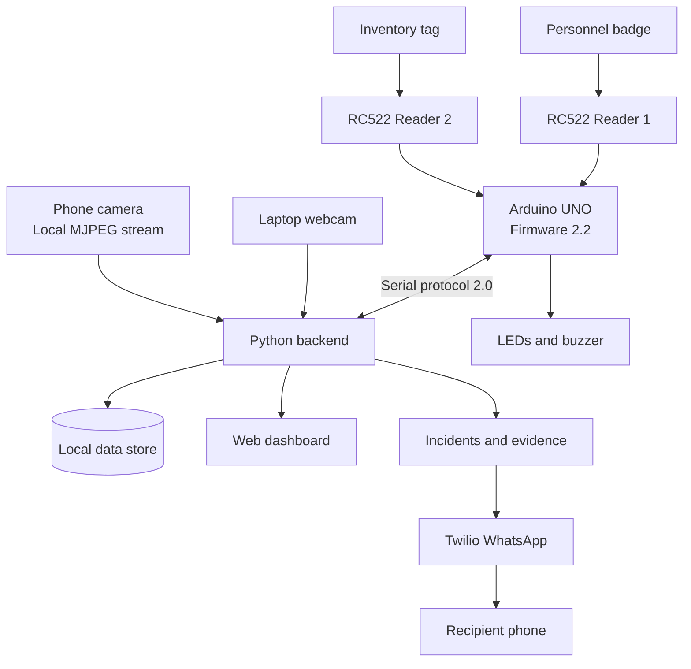

# Inventory Management & RFID-Based Shelf Monitoring System

An integrated hardware/software inventory-monitoring prototype combining
dual RFID readers, an Arduino UNO, a laptop-hosted backend and
dashboard, camera-based shelf monitoring, incident logging, and Twilio
WhatsApp notifications.

> **Status:** The project checkpoint reports firmware 2.2, protocol 2.0,
> successful scan-to-backend-to-feedback tests on both readers, sampled
> feedback of 11 ms per reader, a working 640×480 laptop webcam, working
> LEDs/buzzer, and 69 passing software tests. The latest inbound Twilio
> webhook returned HTTP 200 OK. Phone-camera calibration and confirmed
> end-to-end WhatsApp incident-photo delivery should be verified on the
> deployment machine.

## Contents

-   [Overview](#overview)
-   [Architecture](#architecture)
-   [Hardware and Wiring](#hardware-and-wiring)
-   [How It Works](#how-it-works)
-   [Installation](#installation)
-   [Phone Camera and Shelf
    Calibration](#phone-camera-and-shelf-calibration)
-   [Twilio WhatsApp Setup](#twilio-whatsapp-setup)
-   [Run the System](#run-the-system)
-   [Testing](#testing)
-   [Operational Notes](#operational-notes)
-   [Limitations](#limitations)
-   [Troubleshooting](#troubleshooting)
-   [Project Structure](#project-structure)
-   [References](#references)

## Overview

The system links three kinds of evidence:

1.  **RFID identity and transactions:** personnel badges and item tags
    are scanned using separate readers.
2.  **Shelf observation:** a phone camera watches labelled shelf slots,
    anchors, item markers and reveal markers through a local MJPEG
    stream.
3.  **Incident and notification handling:** the backend compares
    expected RFID activity with visual shelf changes, records incidents,
    and can send configured WhatsApp notifications.

### Main features

-   Personnel badge enrolment and access levels.
-   Badge-declared entry/exit sessions.
-   Inventory item enrolment using separate RFID tags.
-   Issue/return ledger with due-time and return warnings.
-   Shelf monitoring using printed visual markers.
-   Matching of authorized RFID ISSUE events with expected shelf
    removals.
-   Local green/red LED and buzzer feedback.
-   Incident logging and configured evidence capture.
-   Twilio WhatsApp notification pathway.
-   Bounded offline badge authorization on the Arduino.

## Architecture



  -----------------------------------------------------------------------
  Component                           Responsibility
  ----------------------------------- -----------------------------------
  RC522 Reader #1                     Personnel badge scanning

  RC522 Reader #2                     Inventory item-tag scanning

  Arduino UNO                         Reader scheduling, event reporting,
                                      local feedback, alarm/deadman
                                      behavior and bounded offline badge
                                      cache

  Laptop webcam (index `0`)           Gate preview and configured gate
                                      incident-photo workflow

  Phone camera                        Continuous shelf observation via
                                      local MJPEG

  Backend/dashboard                   Personnel, inventory, sessions,
                                      ledger, shelf vision, incidents,
                                      health and notifications

  Twilio                              WhatsApp messaging and status
                                      integration
  -----------------------------------------------------------------------

## Hardware and Wiring

### Components

-   Arduino UNO
-   2 × MFRC522 / RC522 RFID reader modules
-   Buzzer
-   Green LED and red LED, each with its own resistor
-   Laptop webcam
-   Phone camera with a direct MJPEG streaming app
-   Suitable 3.3 V supply and logic-level shifting for the RC522 modules
-   A separate RFID badge for each person and a separate tag for each
    inventory item

### Pin map

  Signal                     UNO pin
  ------------------------ ---------
  Reader 1 SS/SDA                D10
  Reader 1 RST                    D9
  Reader 2 SS/SDA                 D4
  Reader 2 RST                    D5
  Shared SPI SCK                 D13
  Shared SPI MOSI                D11
  Shared SPI MISO                D12
  Buzzer                          D6
  Green LED                       D7
  Red LED                         D8
  Optional future button          A0

Both readers share SPI and ground. **D4 is assigned to Reader 2, not a
button.** `BUTTON_ENABLED` defaults to `0`.

### Firmware profile

  Setting                 Current documented value
  ----------------------- ---------------------------------
  Firmware                `2.2`
  Serial protocol         `2.0`
  Reader count            `2`
  Current hardware port   `COM11`
  Reader scheduling       Alternating RF-field activation

Firmware 2.2 activates one reader antenna at a time to reduce
interaction between the RC522 modules. `tools/compile_firmware.py`
compiles variants and test sketches; it does **not** upload firmware.

## How It Works

1.  An administrator enrols a person's badge under **Personnel** and
    assigns an access level.
2.  The person taps the badge on Reader 1 to open a session. Tapping it
    again closes the session.
3.  Each inventory item is enrolled separately under **Inventory**, with
    its own RFID tag and marker ID.
4.  The item is scanned on Reader 2. The backend checks permissions and
    associates the scan with an eligible active session.
5.  The phone camera observes configured shelf slots and markers.
6.  A permitted ISSUE authorizes one expected removal from the linked
    shelf slot for a limited period.
7.  The visual shelf change is compared with the RFID event. Unexpected
    changes may create incidents and trigger alarms/notifications.

### Core rules

-   A person's badge and an item's tag must have **different UIDs**.
-   The documented default session lifetime is 30 minutes, with a
    maximum of four active sessions.
-   An item scan is attributed to the most recent badge scan within 30
    seconds. After that, attribution is allowed only when exactly one
    session remains active.
-   With multiple possible workers, the system refuses ambiguous
    attribution. Wait for green feedback on the intended badge before
    scanning the item.
-   A permitted available item becomes `ISSUED` and receives a due time.
-   Insufficient level or enabled zone restrictions may produce `PRM`;
    no attributable session produces `NSS`.
-   A known ISSUE authorizes one removal from its linked shelf slot
    within 30 seconds.
-   An undeclared removal with a worker inside starts a warning/grace
    period; the documented default grace period is 10 seconds.
-   Camera occlusion is not proof of theft. An offline, covered or
    unaligned camera should suspend new visual decisions and raise a
    health warning.

## Installation

Commands below follow the documented Windows/PowerShell setup. Run from
the project root:

``` powershell
cd D:\inventorySystem
.\.venv\Scripts\Activate.ps1

python -m pip install -r backend/requirements.lock.txt
npm ci --prefix frontend
npm run build --prefix frontend
```

Run environment initialization only if `.env` does not already contain
the required settings:

``` powershell
python scripts/init_env.py
```

Compile firmware variants:

``` powershell
python tools/compile_firmware.py
```

> The compile helper does not upload firmware. Confirm the correct board
> and COM port before uploading. Back up the data directory with the
> backend stopped before migrations or major changes. Use a separate
> clean `DATA_DIR` for real hardware rather than a seeded simulation
> directory.

## Phone Camera and Shelf Calibration

The two cameras have separate roles:

-   **Laptop webcam:** gate preview and configured gate incident photos.
-   **Phone camera:** continuous shelf observation through a local MJPEG
    stream.

### Start the phone stream

For Android, the project guide specifies **IP Webcam by Pavel
Khlebovich**. On iPhone, use a streaming app that provides a direct
MJPEG URL.

1.  Grant camera permission and select the rear camera.
2.  Connect phone and laptop to the same private Wi-Fi. If campus Wi-Fi
    isolates clients, use a private phone hotspot.
3.  Use landscape orientation, approximately `1280 × 720` and
    `10–15 FPS`.
4.  Start the app's server and note the IP shown on the phone.
5.  For IP Webcam, test the direct stream endpoint:

``` text
http://PHONE_IP:8080/video
```

Open it from the laptop browser. It should show live video, not an HTML
settings page.

### Test both cameras

Stop the backend before camera tests:

``` powershell
python tools/camera_test.py 0 --output data/gate-check.jpg
python tools/camera_test.py http://PHONE_IP:8080/video --output data/phone-check.jpg
```

Replace `PHONE_IP` with the actual address shown by the phone app.

### Configure `.env`

``` dotenv
GATE_CAMERA_INDEX=0
SHELF_STREAM_URL=http://PHONE_IP:8080/video
```

Keep existing settings intact. Restart the backend after editing `.env`.
Do not expose or tunnel the phone-camera port publicly.

### Calibrate the shelf

1.  Start hardware mode and sign in to the dashboard.
2.  Open Calibration and select **Pause shelf rules**.
3.  Ensure all configured items are present and all four corner anchors
    are visible.
4.  Select **Learn shelf** and refine each slot rectangle around its
    item.
5.  Remove each box while setup is paused, confirm the reveal marker
    appears, and select **Capture empty reference**.
6.  Replace the box and repeat for every slot.
7.  Keep anchors visible. Three anchors support an affine fallback; four
    are required for a projective homography.
8.  Select **Resume shelf rules** and verify every slot reports
    `PRESENT`.

Recalibrate after changing the phone IP, orientation, resolution or
camera position.

## Twilio WhatsApp Setup

The documented integration uses the Twilio WhatsApp Sandbox. The
receiving WhatsApp account must join using the exact code shown in
Twilio Console.

### Environment variables

Configure these locally in `.env`:

``` dotenv
TWILIO_ACCOUNT_SID=your_account_sid
TWILIO_AUTH_TOKEN=your_private_auth_token
TWILIO_WHATSAPP_FROM=whatsapp:+sandbox_sender_number
OWNER_WHATSAPP_TO=whatsapp:+country_code_and_owner_number
PUBLIC_BASE_URL=https://your-public-backend-host
NOTIFY_CHANNELS=whatsapp
```

The Account SID and Auth Token must belong to the same Twilio account.
Never commit or share the Auth Token.

### Webhook configuration

Expose the **backend only** through an HTTPS tunnel such as ngrok. If
the backend runs on port `8000`, forward the tunnel to that port.

Set the following POST endpoints in Twilio Sandbox settings, using your
actual public hostname:

  Setting                   Path                         Method
  ------------------------- ---------------------------- --------
  When a message comes in   `/webhooks/twilio/inbound`   `POST`
  Status callback URL       `/webhooks/twilio/status`    `POST`

Set `PUBLIC_BASE_URL` to the same public HTTPS base URL and restart the
backend after changes. Do not tunnel the phone-camera stream.

### Join and test the Sandbox

1.  Send the exact `join ...` code from the receiving WhatsApp account
    to the Sandbox sender.
2.  Save the inbound and status callback URLs.
3.  Send `hello` to the Sandbox number.
4.  Check the backend/ngrok request log for
    `POST /webhooks/twilio/inbound`.
5.  Confirm the inbound request succeeds and inspect notification
    status.

An inbound webhook `200 OK` confirms that the backend accepted that
request. It does not, by itself, prove an automated reply or outbound
alert delivery.

### Test outbound text and photo

Ensure `data/gate-check.jpg` exists:

``` powershell
python tools/twilio_test.py --photo data/gate-check.jpg
```

This can send a real message and image to the configured recipient and
may incur provider charges. Verify receipt on the destination WhatsApp
device. A Twilio `201 CREATED` response means the request was accepted,
not necessarily delivered.

> **Template limitation:** The documented backend does not implement
> approved out-of-window WhatsApp template messaging. If alerts are
> required outside the 24-hour customer-service window, approved
> templates and corresponding backend support are needed.

## Run the System

Close Arduino Serial Monitor and any other process using the Arduino
port. The backend should be the **only process** owning the Arduino and
camera resources.

``` powershell
.\scripts\dev.ps1 -Hardware
```

Open the dashboard:

``` text
http://127.0.0.1:8000
```

### First-time setup checklist

-   [ ] Confirm both cameras are healthy, firmware boot event is present
    and reader count is `2`.
-   [ ] Enrol a personnel badge under Personnel using Reader 1.
-   [ ] Enrol a different item tag under Inventory using Reader 2.
-   [ ] Set item name, marker ID, minimum level and loan duration.
-   [ ] Wait for offline whitelist status `CURRENT`.
-   [ ] Create and link shelf slots to inventory items.
-   [ ] Print/place markers and complete shelf calibration.
-   [ ] Resume shelf rules only after all slots show the expected
    resting state.

## Testing

Reported project checkpoint results:

  -----------------------------------------------------------------------
  Area                                Reported result
  ----------------------------------- -----------------------------------
  Software test suite                 69 tests passed

  Firmware                            2.2, protocol 2.0

  Dual RFID readers                   Both completed scan → backend
                                      response → feedback

  Sampled feedback time               11 ms per reader

  Laptop webcam                       640 × 480 capture successful

  LEDs and buzzer                     Confirmed working

  Twilio inbound webhook              Latest test returned `200 OK`

  Twilio outbound API                 Console test returned
                                      `201 CREATED`; delivery must be
                                      verified

  Phone shelf camera                  Stream and calibration must be
                                      verified on target installation
  -----------------------------------------------------------------------

### Recommended acceptance test

-   [ ] Verify firmware 2.2 and two-reader boot status.
-   [ ] Confirm the backend owns the correct serial port.
-   [ ] Enrol one personnel badge and a separate inventory item tag.
-   [ ] Test badge session open/close on Reader 1.
-   [ ] Test permitted item ISSUE on Reader 2.
-   [ ] Remove the item and confirm shelf verdict `MATCHED`.
-   [ ] Scan RETURN and replace the item.
-   [ ] Test insufficient access level and confirm `PRM`.
-   [ ] Test undeclared removal under supervised conditions.
-   [ ] Confirm phone camera and shelf anchors are healthy.
-   [ ] Confirm inbound Twilio webhook succeeds.
-   [ ] Run outbound text/photo test and verify actual receipt.
-   [ ] Review ledger, incidents and notification status.

## Operational Notes

-   Keep Arduino Serial Monitor closed while the backend owns `COM11`.
-   Only one backend instance should own the Arduino and camera
    resources.
-   Keep the phone charged, ventilated and awake; disable battery
    optimization for the streaming app if needed.
-   The phone stream URL is local. Never expose its camera port through
    a public tunnel.
-   If the phone IP changes, update `SHELF_STREAM_URL`, restart the
    backend and recalibrate.
-   Back up the entire `DATA_DIR` with the backend stopped before
    migrations or major changes.
-   Use a separate clean `DATA_DIR` for real hardware rather than the
    seeded simulation directory.
-   Internet/Twilio failure must not be confused with local alarm
    failure.

## Limitations

This is a supervised lab prototype, not a certified access-control or
theft-prevention system.

-   There is no physical gate barrier or door-direction sensor.
-   `IN` and `OUT` represent badge-tap declarations, not verified
    physical passage.
-   The phone camera does not read RFID, perform facial recognition or
    identify people.
-   Marker-only monitoring may be defeated if a marker is detached and
    left in view.
-   Camera occlusion or loss of alignment is not proof of theft.
-   The Arduino offline cache does not provide the laptop's full ledger,
    shelf vision, zone database or session-expiry jobs.
-   Offline events may require manual review and reconciliation.
-   Physical power loss can discard controller RAM events and sessions.
-   WhatsApp delivery depends on Twilio configuration, network access,
    Sandbox/template rules and accessible media URLs.

## Troubleshooting

  -----------------------------------------------------------------------
  Symptom                             Checks
  ----------------------------------- -----------------------------------
  Reader does not scan                Check 3.3 V supply, level shifting,
                                      common ground, wiring and firmware.

  Reader interaction                  Confirm firmware 2.2 and
                                      alternating reader activation.

  Backend cannot open Arduino         Close Arduino Serial Monitor and
                                      other serial clients; verify COM
                                      port.

  Phone camera offline                Confirm stream is running,
                                      phone/laptop network reachability,
                                      `/video` endpoint and
                                      `SHELF_STREAM_URL`.

  Shelf decisions suspended           Check camera health, anchor
                                      visibility, alignment and
                                      calibration.

  Twilio webhook returns 403          Check exact `PUBLIC_BASE_URL` and
                                      matching Account SID/Auth Token. Do
                                      not disable signature validation.

  Twilio returns 201 but no WhatsApp  Check Sandbox membership,
  message                             recipient, provider status and
                                      session/template requirements.

  Photo alert has no image            Confirm image exists and its media
                                      URL is publicly reachable over
                                      HTTPS.
  -----------------------------------------------------------------------

## Project Structure

This is a **high-level map of paths referenced by the operating guide**,
not a complete recursive repository listing.

``` text
D:\inventorySystem
├── backend/
│   ├── app/
│   │   ├── main.py
│   │   ├── config.py
│   │   └── services/
│   │       └── notifier.py
│   ├── requirements.lock.txt
│   └── tests/
├── firmware/
│   └── arduino_gate/
├── frontend/
├── scripts/
│   ├── init_env.py
│   └── dev.ps1
├── tools/
│   ├── camera_test.py
│   ├── compile_firmware.py
│   ├── hw_selftest.py
│   ├── protocol_conformance.py
│   └── twilio_test.py
├── data/
└── .env
```

Some files and directories may exist beyond this map. Do not commit
`.env`, private credentials, generated incident photos or local hardware
data unless explicitly intended.

## Safety

-   RC522 modules require 3.3 V. Verify module current requirements.
-   Use suitable level shifting on UNO-to-RC522 output lines.
-   Ensure devices share the correct ground.
-   Use resistors for LEDs and verify buzzer drive requirements.
-   Have the wiring checked by a qualified instructor/technician before
    applying power.

## References

-   [Arduino UNO Rev3 pinout and electrical
    reference](https://content.arduino.cc/assets/Pinout-UNOrev3_latest.pdf)
-   [NXP MFRC522
    datasheet](https://www.nxp.com/docs/en/data-sheet/MFRC522.pdf)
-   [Twilio WhatsApp
    Sandbox](https://www.twilio.com/docs/whatsapp/sandbox)
-   [Twilio WhatsApp media
    messages](https://www.twilio.com/docs/whatsapp/tutorial/send-and-receive-media-messages-twilio-api-whatsapp)
-   [Twilio request signature
    validation](https://www.twilio.com/docs/usage/security)

------------------------------------------------------------------------

**Built as an integrated hardware/software inventory-monitoring
prototype.**
